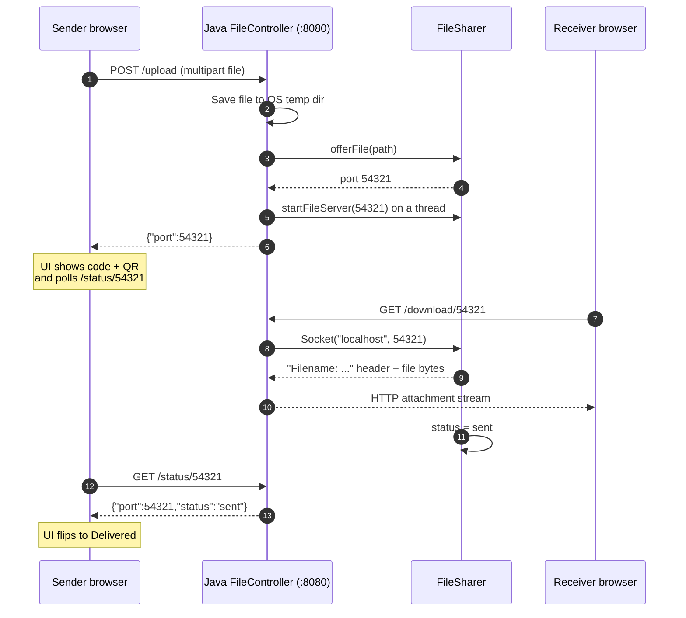

<div align="center">

  <h1>ZipZapZoop</h1>
  <p><strong>A socket-based file handoff with a five-digit code.</strong></p>
  

  <p>
    
    
    
    
    
  </p>

  <p>
    <a href="#quick-start"><strong>Quick start</strong></a> ·
    <a href="#how-it-works"><strong>How it works</strong></a> ·
    <a href="#api-reference"><strong>API</strong></a> ·
    <a href="DEMO.md"><strong>Professor demo guide</strong></a>
  </p>
</div>

---

## What is ZipZapZoop?

ZipZapZoop turns a file into a **five-digit handoff code**. A sender stages a
file locally, shares the code (or a QR code), and a receiver enters the code to
pull the bytes over a raw TCP socket.

The project is intentionally small enough to explain end to end:

- **No accounts** — there is nothing to sign up for.
- **No database** — staged files live in the OS temp directory.
- **No cloud storage bucket** — the Java process serves the file.
- **No build-time magic in the transfer path** — uploads and downloads are
  plain HTTP requests around a TCP `ServerSocket`.

The interface is a pastel neobrutalist console with live telemetry, a scannable
QR code, a local session log, and a sender-side delivery receipt.

> **What “P2P” means here:** ZipZapZoop is a **socket-based, server-assisted
> handoff**, not browser-to-browser WebRTC and not BitTorrent. The browser is
> the control surface; the Java process is the data plane. The receiver talks
> to the Java service, and the Java service connects to a local `ServerSocket`
> that streams the staged file. This is a deliberate simplification for a
> networking demo, and the code is honest about it.

---

## Why it is interesting

| Feature | What it demonstrates |
| --- | --- |
| **Five-digit invite code** | A random dynamic port (`49152–65535`) doubles as the share code. |
| **Raw TCP stream** | Java `ServerSocket` + `Socket` APIs move the file, not a storage API. |
| **QR + invite link** | `/?code=54321` opens the receive tab with the code prefilled. |
| **Live telemetry** | XHR progress is turned into throughput, elapsed time, ETA, and a sparkline. |
| **Sender delivery receipt** | The sender polls `/status/{port}` and flips to **Delivered** after the bytes are served. |
| **Local session log** | Recent sends and receives are stored in `localStorage`, not on a server. |
| **Ephemeral lifecycle** | One download per upload; the `ServerSocket` closes after the transfer. |

---

## Quick start

### Prerequisites

- **Java 17+**
- **Maven 3.9+**
- **Node.js 20+** and **npm**
- A modern browser (Chrome, Edge, Firefox, or Safari)

### 1. Build and start the Java backend

From the repository root:

```bash
mvn clean package
java -jar target/p2p-1.0-SNAPSHOT.jar
```

The API starts on **`http://localhost:8080`**. Leave this terminal open.

### 2. Start the Next.js UI

In a second terminal:

```bash
cd ui
npm install
npm run dev
```

Open **`http://localhost:3000`**.

For a production-style run:

```bash
cd ui
npm run build
npm run start -- -H 0.0.0.0 -p 3000
```

The backend must be running before the UI can upload or download.

### 3. Send a file

1. Open the **Share a file** tab.
2. Drop a file into the zone.
3. Wait for staging to finish. A five-digit code, QR code, and invite link
   appear.
4. Share the code, link, or QR with the receiver.

### 4. Receive a file

1. Open the **Receive a file** tab.
2. Enter the five-digit code, or open `/?code=54321` / scan the QR code.
3. Press **Download**. The file is saved through the browser's normal download
   flow.

The sender's live session changes from **staged** to **Delivered to receiver**
after the backend reports that the file stream completed.

> **One download per upload.** The backend closes the `ServerSocket` after the
> first receiver. Upload another file to create a new code for a second demo.

---

## How it works



### The transfer lifecycle

The backend tracks every staged code in memory:

| Status | Meaning | UI |
| --- | --- | --- |
| `staged` | The file is saved and the `ServerSocket` is waiting. | Sender sees **File staged · waiting for receiver**. |
| `sending` | A receiver connected and bytes are being written. | Sender briefly remains in the waiting state. |
| `sent` | The file stream completed and the socket closed. | Sender sees **Delivered to receiver**; history chip becomes **Delivered**. |
| `error` | The server socket or file stream failed. | Sender sees **Session interrupted** / **Delivery failed**. |

Status is **in memory** and is cleared when the Java process restarts. A code is
also single-use: after one successful download, the `ServerSocket` is closed.

### What “sent” does and does not prove

The sender-side receipt means:

> The Java service finished writing the file bytes to the download handler and
> flushed the stream.

It does **not** cryptographically prove that the receiver's browser saved the
file to disk. A true end-to-end acknowledgement would require the receiver to
POST an ACK after `saveBlob`, which is listed in the roadmap. The wording in the
UI is deliberately “Delivered to receiver” for the demo, while this README calls
out the distinction.

### Why the code is a port

`UploadUtils.generateCode()` chooses a random number in the dynamic/private port
range, **49152–65535**. `FileSharer.offerFile()` reserves that number and
`startFileServer()` opens a `ServerSocket` on it, then returns the code to the
UI. The code is therefore both:

- a human-friendly invitation, and
- the actual TCP port the sender's file server listens on.

That is the core networking idea the project is meant to show.

---

## Project structure

```text
ZipZapZoop/
├── pom.xml
├── readme.md
├── DEMO.md
├── src/main/java/p2p/
│   ├── App.java                     # entry point; starts FileController on :8080
│   ├── controller/FileController.java
│   │   ├── UploadHandler            # POST /upload
│   │   ├── DownloadHandler          # GET /download/{port}
│   │   ├── StatusHandler            # GET /status/{port}
│   │   └── CORSHandler              # permissive demo CORS
│   ├── service/FileSharer.java      # ServerSocket lifecycle + status map
│   └── utils/UploadUtils.java       # random dynamic port generation
└── ui/
    ├── next.config.ts               # /api/* rewrites to localhost:8080
    ├── package.json
    └── src/
        ├── app/page.tsx             # console state, upload/download flow, polling
        ├── components/
        │   ├── FileUpload.tsx       # drag-and-drop staging
        │   ├── FileDownload.tsx     # five-box code input
        │   ├── InviteCode.tsx       # code, QR, copy/share, delivered state
        │   ├── TransferMonitor.tsx  # ring, telemetry, lifecycle steps
        │   └── SessionHistory.tsx   # local recent-handoff log
        └── lib/
            ├── transfer.ts          # XHR upload/download + status fetch
            ├── history.ts           # localStorage history
            └── format.ts            # bytes/speed/duration formatting
```

---

## API reference

The Java backend exposes three JSON/binary endpoints. The UI calls them through
Next.js rewrites:

| UI path | Backend path |
| --- | --- |
| `POST /api/upload` | `POST http://localhost:8080/upload` |
| `GET /api/download/{port}` | `GET http://localhost:8080/download/{port}` |
| `GET /api/status/{port}` | `GET http://localhost:8080/status/{port}` |

### `POST /upload`

Stages a file and returns a new invite code.

- **Content-Type:** `multipart/form-data`
- **Field name:** `file`
- **Response:** `200 OK`

```json
{ "port": 54321 }
```

Errors: `400` for a malformed multipart request, `500` for a server-side write
failure.

### `GET /download/{port}`

Streams the staged file as an attachment.

- **Response:** binary stream
- **Headers:** `Content-Disposition: attachment; filename="..."`,
  `Content-Type: application/octet-stream`
- **Behavior:** connects to the sender's `ServerSocket`, writes the bytes to a
  temporary file, then streams that file to the receiver.
- **One-shot:** a second request for the same code will fail because the sender
  socket has closed.

### `GET /status/{port}`

Returns the sender-side lifecycle state.

```json
{ "port": 54321, "status": "staged" }
```

Possible `status` values: `staged`, `sending`, `sent`, `error`.

- `404` if the code is unknown (for example, after a backend restart).
- `400` if the path does not contain a valid integer port.

### cURL examples

```bash
# 1. Stage a file. Replace the path with your own file.
curl -F "file=@demo.txt" http://localhost:8080/upload
# -> {"port": 54321}

# 2. Check the sender-side state.
curl http://localhost:8080/status/54321
# -> {"port":54321,"status":"staged"}

# 3. Download it once.
curl http://localhost:8080/download/54321 -o downloaded-demo.txt

# 4. Check the receipt.
curl http://localhost:8080/status/54321
# -> {"port":54321,"status":"sent"}
```

---

## Demo mode: showing it from a phone

The UI and backend can run on one laptop while the receiver uses a phone.

### Option A — same Wi-Fi / LAN

1. Start the UI listening on all interfaces:

   ```bash
   cd ui
   npm run build
   npm run start -- -H 0.0.0.0 -p 3000
   ```

2. Find the laptop's LAN address:

   ```bash
   hostname -I
   # e.g. 192.168.1.42
   ```

3. Open `http://192.168.1.42:3000` on the laptop **and** the phone. Use this
   URL on both devices so the generated QR code contains a reachable address.

If the phone cannot reach the laptop (common on Android hotspot host-to-client
routing), use the tunnel option instead.

### Option B — temporary Cloudflare quick tunnel

This is the most reliable option when the phone is on a different network or
the hotspot isolates clients.

```bash
# Terminal 1: backend
java -jar target/p2p-1.0-SNAPSHOT.jar

# Terminal 2: UI
cd ui
npm run build
npm run start -- -H 0.0.0.0 -p 3000

# Terminal 3: public tunnel
cloudflared tunnel --url http://localhost:3000 --no-autoupdate
```

`cloudflared` prints a URL like:

```text
https://something-random.trycloudflare.com
```

Open that HTTPS URL on **both** the laptop and the phone. The QR code will then
encode a URL the phone can actually reach.

Quick-tunnel caveats:

- The URL changes whenever `cloudflared` restarts.
- A `530` can appear while the tunnel reconnects; wait a few seconds and reload.
- Quick tunnels are for demos only. Do not send sensitive files through one.

---

## Demo guide

A complete, presentation-ready script lives in **[DEMO.md](DEMO.md)**. It
includes:

- a pre-demo checklist,
- a timed 5-minute walkthrough,
- exact talking points,
- phone/tunnel setup,
- failure drills, and
- Q&A prep.

The short version:

1. Show the landing page and the console.
2. Drop a visually interesting file.
3. Call out the code, QR, and “staged, not delivered” state.
4. Scan the QR on the phone; the receive tab opens prefilled.
5. Download on the phone.
6. Point at the sender tab flipping to **Delivered** and the session log
   updating to **Delivered**.
7. Explain the socket path with the architecture diagram.
8. Close with the honest limitations and next steps.

---

## Verification

Run the same checks used while developing this version:

```bash
# Backend
mvn -q -DskipTests package

# Frontend
cd ui
npx tsc --noEmit
npm run lint
npm run build
```

End-to-end smoke test (with backend and UI running):

```bash
set -euo pipefail
printf 'zipzapzoop delivery test\n' > /tmp/zipzapzoop-test.txt
upload=$(curl -fsS -F "file=@/tmp/zipzapzoop-test.txt" http://localhost:3000/api/upload)
port=$(printf '%s' "$upload" | sed -E 's/.*"port":[[:space:]]*([0-9]+).*/\1/')
sleep 1
echo "before: $(curl -fsS "http://localhost:3000/api/status/$port")"
curl -fsS -o /tmp/zipzapzoop-download.txt "http://localhost:3000/api/download/$port"
sleep 1
echo "after:  $(curl -fsS "http://localhost:3000/api/status/$port")"
cmp /tmp/zipzapzoop-test.txt /tmp/zipzapzoop-download.txt
echo "OK: downloaded bytes match the original file"
```

There is no automated backend test suite yet; this smoke test exercises the
upload, download, and status-receipt path.

---

## Security and limitations

> **This is a demonstration project, not a production file-sharing service.**

- **No authentication** — anyone who knows a code can attempt a download.
- **No encryption** — TCP and HTTP traffic are plaintext unless you put them
  behind HTTPS/TLS (the Cloudflare tunnel provides transport encryption for the
  demo).
- **Codes are guessable** — the code space is the dynamic port range, not a
  cryptographic secret.
- **Single receiver** — each upload accepts one connection.
- **No resume** — an interrupted transfer cannot be resumed.
- **In-memory status** — restarting the backend loses all codes and statuses.
- **Temp storage** — staged files live under the OS temp directory and are not
  guaranteed to be cleaned up automatically.
- **No file size limits** — bounded by available disk/memory and the browser.
- **No NAT traversal** — the backend binds a local port; a tunnel or port
  forwarding is needed for remote receivers.

Good uses: classroom demos, local-network handoffs, networking experiments, and
prototype UX work. Do not use it for confidential data.

---

## Roadmap

- Receiver ACK endpoint for true end-to-end delivery confirmation.
- Opt-in encryption / TLS for the data path.
- Chunked, resumable transfers with checksums.
- Multiple receivers per staged file.
- TTL-based cleanup of staged files and statuses.
- Authentication and rate limiting for public deployments.
- Optional WebRTC path for true browser-to-browser transfer.

---

## Troubleshooting

| Symptom | Likely cause | Fix |
| --- | --- | --- |
| “Could not reach the transfer server” | Java backend is not running. | Start `java -jar target/p2p-1.0-SNAPSHOT.jar` and check port 8080. |
| “No file answered on port …” | Wrong code, already-used code, or backend restarted. | Upload a fresh file and use the new code. |
| Sender stays on “File staged” | The receiver has not completed the download. | Check the code, then watch `/status/{port}`. |
| Sender flips to “Session expired” | The backend restarted and lost the in-memory code. | Upload again. |
| QR code opens `localhost` on the phone | The UI was opened via `localhost` instead of LAN/tunnel URL. | Use the laptop's LAN IP or the Cloudflare URL on both devices. |
| Phone cannot open the LAN URL | Hotspot client isolation or firewall. | Use the Cloudflare quick tunnel. |
| Tunnel shows `530` | Quick tunnel reconnecting. | Wait a few seconds and reload; restarting the tunnel changes the URL. |
| Port 8080 already in use | Old backend process still running. | Stop it (`pkill -f p2p-1.0-SNAPSHOT.jar`) and restart. |
| `next: not found` | UI dependencies not installed. | `cd ui && npm install`. |
| Download does not appear on phone | Browser blocked the download or the blob could not be saved. | Check the browser's download notification/permissions. |

---

## Built with

- **Java 17** — `com.sun.net.httpserver.HttpServer`, `ServerSocket`, `Socket`
- **Maven** — build and shaded JAR packaging
- **Next.js 15.5** + **React 19** + **TypeScript**
- **Tailwind CSS 4** — pastel neobrutalist design system
- **Framer Motion** — card and confirmation animations
- **Radix UI** — tabs and accessible primitives
- **qrcode.react** — invite QR codes
- **Lucide React** — iconography
- **Apache Commons IO** — multipart and stream helpers

---

<div align="center">
  <p><strong>Send a file. Share a code. That’s it.</strong></p>
  <p><a href="#quick-start">Quick start</a> · <a href="DEMO.md">Demo guide</a></p>
</div>
